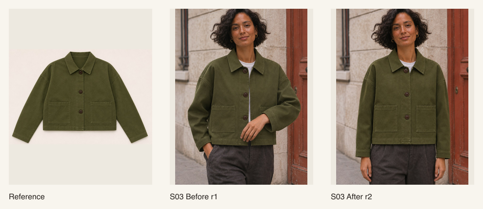
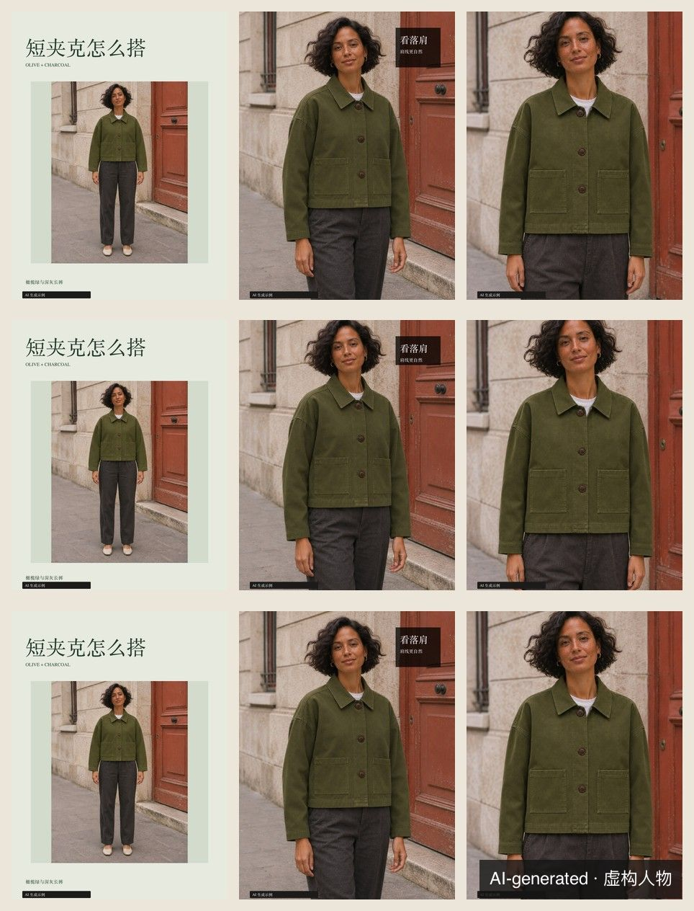

# Fashion Street Editorial Skills

[](https://github.com/isook527/fashion-street-editorial-skills/actions/workflows/test.yml)
[](LICENSE)
[](https://github.com/isook527/fashion-street-editorial-skills/releases/latest)

[简体中文](README.zh-CN.md)

Two standalone agent skills for Claude Code, Claude.ai and Codex that plan fashion shoots around the details shoppers need to see and turn approved photos into Instagram and Xiaohongshu carousels.



The jacket reference shows two patch pockets. The first draft hides one behind the model’s hand. The revised shot moves the hand away, so both pockets can be checked.

## What you can do

- **Check the details you planned to show.** Give each garment detail a shot and a visible pass condition. If a pocket is hidden, keep the failed draft and redo that shot.
- **Rebuild only the pages that changed.** Replacing a photo or editing a headline identifies the pages that need to be rendered and reviewed again.
- **Preview the cover for each export.** Export 3:4 or 4:5 PNG and editable SVG. Check safe areas, a 360 px preview, and a simulated Instagram grid crop before posting.



## Quick start

With Node.js 20.9+ and npm, run the following from the repository root. The [editorial jacket demo](examples/editorial-jacket/project.json) uses approved sample shots and writes three editions to a new directory.

```sh
npm ci --prefix skills/ins-editorial-layout
npm run fonts --prefix skills/ins-editorial-layout
node skills/ins-editorial-layout/scripts/project.cjs editions examples/editorial-jacket/project.json --formats xhs34,ig34,ig45 --out demo-editions
```

## Install

**Claude Code.** Copy each skill folder into `<project>/.claude/skills/` or `~/.claude/skills/`. Describe your task in chat or invoke `/ai-outfit-blogger` or `/ins-editorial-layout`. [Claude Code skill guide](https://code.claude.com/docs/en/skills)

**Claude.ai.** Download `ai-outfit-blogger-<version>.zip` or `ins-editorial-layout-<version>.zip` from Releases and upload it under **Customize → Skills** with code execution enabled. If the sandbox can run Node.js but cannot install npm packages, the layout renderer exports SVG only. [Claude skill upload guide](https://support.claude.com/en/articles/12512198-how-to-create-custom-skills)

**Codex.** Copy each skill folder into the project’s `.agents/skills/`. Open the project in Codex and invoke `$ai-outfit-blogger` or `$ins-editorial-layout`.

**Layout setup.** In the installed `ins-editorial-layout` folder, run `npm ci` and then `npm run fonts`. The font command downloads about 40 MB and verifies both files against pinned SHA-256 checksums. To install the fonts from local files, run `npm run fonts -- --from <dir>`. If Node.js is available without sharp, use `render.cjs` or `render-carousel.cjs` for SVG exports.

## Start your own project

Create a product shoot project with starter profiles.

```sh
node skills/ins-editorial-layout/scripts/project.cjs init my-shoot --mode product
```

Check the project and profile fields before planning.

```sh
node skills/ins-editorial-layout/scripts/project.cjs validate my-shoot/project.json
```

List the shots and identify missing references and creative inputs.

```sh
node skills/ins-editorial-layout/scripts/project.cjs plan my-shoot/project.json
```

`copy` and `deliver` run copy risk checks automatically. With `--strict`, either command fails when it finds a block-level hit.

## The two skills

### [AI Outfit Blogger](skills/ai-outfit-blogger/SKILL.md)

Start with a garment brief, references, and the details each shot needs to show. The skill returns a creative brief, a shot list, generation prompts, acceptance checks, and captions. Use it for OOTD, lookbooks, street style, and product-faithful apparel shots. It excludes single-photo retouching, non-apparel products, real-person face swaps, and underage models.

### [Ins Editorial Layout](skills/ins-editorial-layout/SKILL.md)

Start with existing photos or a project with approved shots. The skill produces magazine covers and carousels as editable SVG and PNG, with page order, cover previews, and copy. Use it for Xiaohongshu or Instagram layouts and page-level revisions. Photo generation, photo edits, video, and print CMYK are outside its scope.

## Evaluation

The evaluation set contains 40 trigger requests and five tasks. The task protocol compares fresh runs with and without the skills under the same conditions. [Evaluation results and pending runs](docs/evals.md)

All five Codex task comparisons are complete, with the largest gap on task 02, at 18/18 with the skill and 15/18 without it. The 40-request trigger study is pending.

## Boundaries

- Obtain permission for real-person likenesses and record its scope. Use fictional people when permission is unavailable.
- Use adult models who look adult. Keep real-person face swaps outside the workflow.
- Use product references you have permission to use. Avoid reproducing brand logos, trademarks, and protected prints.
- Preserve AI labels and disclose generated content using the publishing platform’s controls.
- Write copy about observable details. Avoid body-type guarantees, claimed effects, and medical promises.

Sample people and garments in this repo are AI-generated and fictional.

## Contributing and license

Development and submission instructions are in the [contributor guide](CONTRIBUTING.md). Code is licensed under [MIT](LICENSE). The optional fonts are licensed under [SIL OFL 1.1](skills/ins-editorial-layout/fonts/NOTICE.md).
