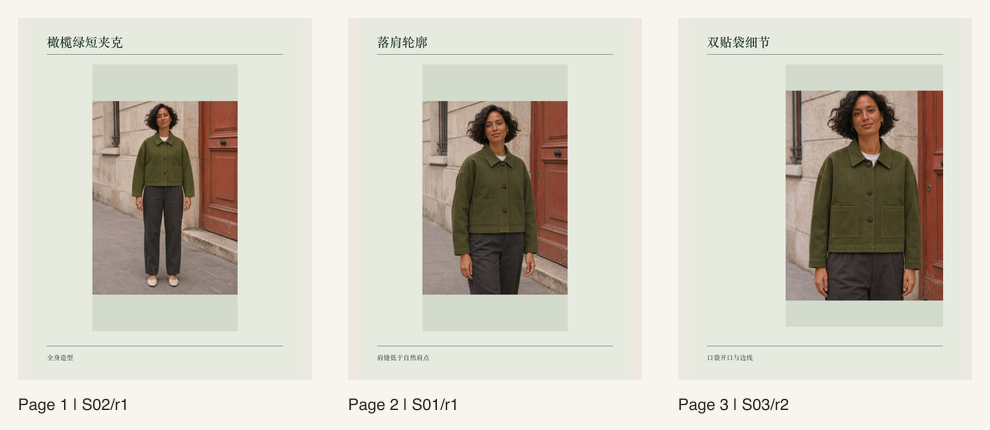
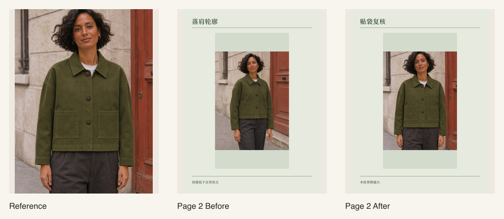

# 街拍穿搭与 Ins 排版 Skills

两套可独立使用的 Codex Skills，也可以用一份项目单把服装卖点、街拍分镜、入选稿和轮播页串起来。



## 一件短夹克怎么交付

| 卖点 | 镜头 | 怎么验收 | 失败时 |
| --- | --- | --- | --- |
| 落肩 | S01 正侧半身 | 肩点和低肩缝可见 | 调整机位，只补 S01 |
| 短衣长 | S02 正面全身 | 衣摆和鞋完整，衣摆止于腰线附近 | 退机位，只补 S02 |
| 双贴袋 | S03 正面中近景 | 两个袋口和边线清楚，手臂离开衣身 | 移开遮挡，只补 S03 |

用 [样例项目单](examples/short-jacket/project.json) 可以重放已记录的出图审阅、三页轮播和定点返工。下图中间一稿故意保留遮挡，右侧为单镜头修订结果。


换图或改字后，项目清单会标记受影响的页。实测替换第 2 页后，只需重新渲染这一页。



## 两个 Skill

- [AI 街拍穿搭](skills/ai-outfit-blogger/SKILL.md) 支持商品保真和创意街拍，规划 CCD、lookbook 和短动态分镜。结合人物、商品、场景和动作参考，按镜头复核并补做。图片和视频生成由宿主工具提供。
- [Ins 排版](skills/ins-editorial-layout/SKILL.md) 包含 20 款版式与四套配色，可应用品牌档案中的字体、留白和封面规则。支持首页预览、整组导出、单页重排，交付可编辑 SVG、1200 × 1600 PNG、缩略图和页序清单。

## 安装

下载 Release 中的 ZIP 并解压。在仓库根目录运行以下命令，将 Skill 安装到新的项目目录。排版需要 Node.js 20.9 或以上及 npm。

```bash
repo="$PWD"
mkdir -p "$HOME/fashion-demo/.agents/skills"
cp -R "$repo/skills/ai-outfit-blogger" "$HOME/fashion-demo/.agents/skills/"
cp -R "$repo/skills/ins-editorial-layout" "$HOME/fashion-demo/.agents/skills/"
cd "$HOME/fashion-demo/.agents/skills/ins-editorial-layout"
npm ci
cd "$HOME/fashion-demo"
```

在 Codex 中打开该项目，用 `$ai-outfit-blogger` 或 `$ins-editorial-layout` 调用。直接运行仓库样例时，在仓库根目录执行：

```bash
npm ci --prefix skills/ins-editorial-layout
node skills/ins-editorial-layout/scripts/project.cjs plan examples/short-jacket/project.json
node --test tests/project.test.cjs
```

从接单到最终交付的命令见 [项目工作流](skills/ins-editorial-layout/references/project-workflow.md)。旧单页和普通轮播用法见 [版式清单](skills/ins-editorial-layout/references/layouts.md) 和 [轮播说明](skills/ins-editorial-layout/references/carousel.md)。

## 实测与样例

短夹克测试记录 3 个镜头、4 次出图，贴袋遮挡负例被拒后单独重做。软件测试覆盖缺图、工具与预算判断、超长中文标题、重复图、裁切警告、单页重排与导出校验。条纹、反光、长下摆和侧脸的实测观察见 [验证记录](docs/validation.md)。

源码和文档使用 [MIT 许可证](LICENSE)。依赖沿用各自许可证。仓库样例来自原创提示词生成的虚构人物与商品。
