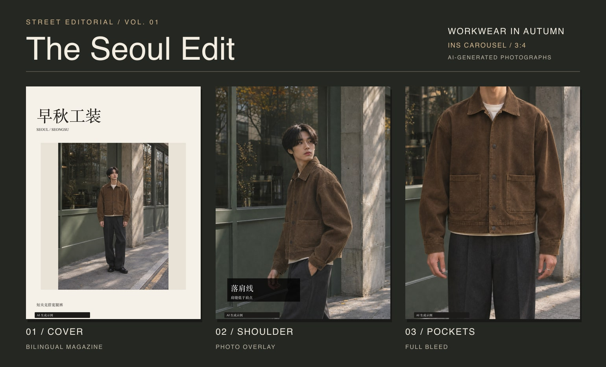
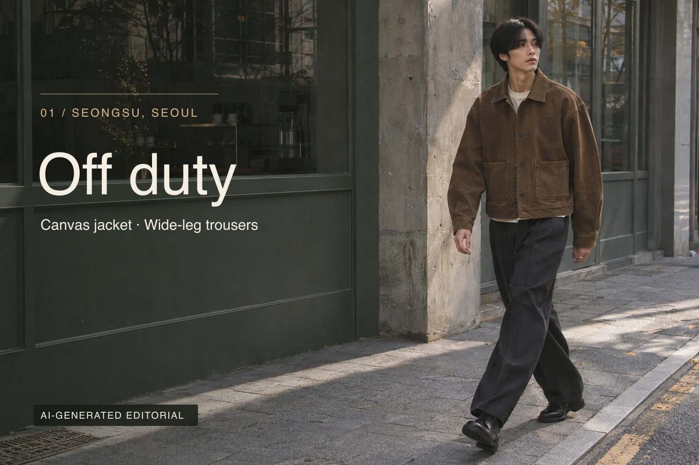
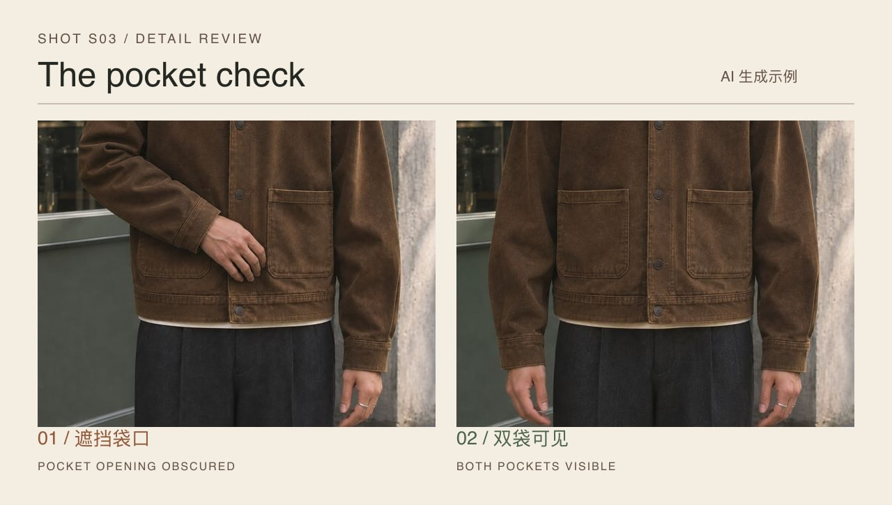
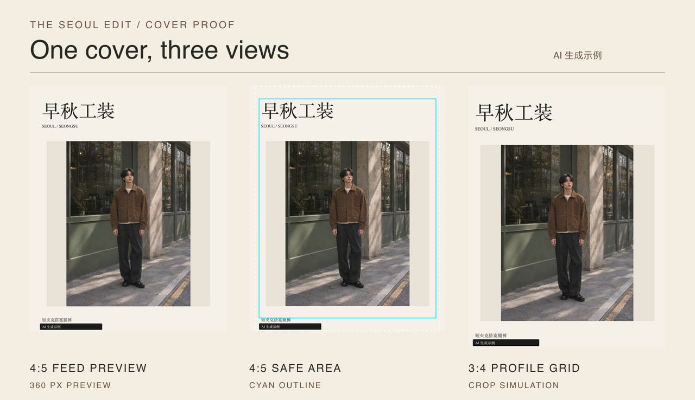

# 街拍穿搭与 Ins 排版 Skills

[](https://github.com/isook527/fashion-street-editorial-skills/actions/workflows/test.yml)
[](LICENSE)
[](https://github.com/isook527/fashion-street-editorial-skills/releases/latest)

[English](README.md)

两套可独立用于 Claude Code、Claude.ai 和 Codex 的 Skills。从一件衣服出发，定街拍分镜、选照片，再排成 INS 或小红书轮播。可导出 PNG 和可编辑 SVG。

**[下载两个 Skill](https://github.com/isook527/fashion-street-editorial-skills/releases/latest)** · [查看同款轮播配置](examples/seoul-workwear/carousel.json)



## 先拍一套有变化的街拍

首尔圣水洞的早秋街景，一件烟草棕帆布短夹克，配白 T 和炭灰宽腿裤。全身看衣长和裤型，半身转肩看肩线，近景看贴袋和走线。[创意简报](skills/ai-outfit-blogger/references/creative-direction.md)



## 一件短夹克怎么验收

| 要看的细节 | 选哪一镜 | 怎么验收 | 失败时 |
| --- | --- | --- | --- |
| 落肩 | S01 正侧半身 | 肩缝低于肩点 | 调整机位，只补 S01 |
| 短衣长 | S02 正面全身 | 看清衣摆和腰线，双鞋完整 | 退机位，只补 S02 |
| 双贴袋 | S03 正面近景 | 两个袋口及边线都看得清 | 移开手臂，只补 S03 |



## 发出前看一遍封面

同一套轮播可导出 INS 3:4、INS 4:5 和小红书 3:4。先看 360 px 信息流预览，再核对标题、人物和衣摆在主页网格模拟裁切中的位置。替换某张照片或改字后，项目清单会标记需要重排的页。



## 两个 Skill

- [AI 街拍穿搭](skills/ai-outfit-blogger/SKILL.md) 支持商品保真和创意街拍，规划 CCD、lookbook 和短动态分镜。结合人物、商品、场景和动作参考，按镜头复核并补做。图片和视频生成由宿主工具提供。
- [Ins 排版](skills/ins-editorial-layout/SKILL.md) 包含 24 款版式，含满版、照片压字、大数字和中英杂志排版。支持按 IG 和小红书预设导出 3:4 与 4:5，提供封面安全区、360 px 信息流预览及 IG 网格裁切模拟。两款开源中文字体可按需安装，交付可编辑 SVG、PNG、页序清单和配套文案。

## 安装

**Claude Code**。把 Skill 目录复制到项目的 `.claude/skills/` 或个人目录 `~/.claude/skills/`。用自然语言描述任务，也可直接输入 `/ai-outfit-blogger` 或 `/ins-editorial-layout`。[Claude Code 安装说明](https://code.claude.com/docs/en/skills)

**Claude.ai**。从 Release 下载对应的 `ai-outfit-blogger-<版本>.zip` 或 `ins-editorial-layout-<版本>.zip`，开启代码执行后，到「自定义 → Skills」上传。沙箱能运行 Node.js 但无法安装 npm 包时，排版脚本只导出 SVG。[Claude 技能上传说明](https://support.claude.com/en/articles/12512198-how-to-create-custom-skills)

**Codex**。把 Skill 目录复制到项目的 `.agents/skills/`。在 Codex 打开项目，用 `$ai-outfit-blogger` 或 `$ins-editorial-layout` 调用。

**排版依赖**。需要 Node.js 22 或以上。进入已安装的 `ins-editorial-layout` 目录，先运行 `npm ci`，再运行 `npm run fonts`。字体约 40 MB，下载后会校验两份文件的 SHA-256。离线安装字体可运行 `npm run fonts -- --from <目录>`。有 Node.js 但缺少 sharp 时，可用单页或轮播脚本导出 SVG。

## 新建自己的项目

新建商品拍摄项目及档案模板。

```sh
node skills/ins-editorial-layout/scripts/project.cjs init my-shoot --mode product
```

在分镜前检查项目单与档案字段。

```sh
node skills/ins-editorial-layout/scripts/project.cjs validate my-shoot/project.json
```

列出镜头安排及待补的参考和创意信息。

```sh
node skills/ins-editorial-layout/scripts/project.cjs plan my-shoot/project.json
```

`copy` 和 `deliver` 会自动运行文案风险检查，加 `--strict` 后遇到 block 级命中会直接失败。

## 运行仓库样例

在仓库根目录运行以下命令，可以导出首页的三页首尔轮播。

```sh
npm ci --prefix skills/ins-editorial-layout
npm run fonts --prefix skills/ins-editorial-layout
node skills/ins-editorial-layout/scripts/render-carousel.cjs examples/seoul-workwear/carousel.json --out-dir seoul-carousel
```

要验证卖点分镜、三套尺寸和成套交付，可继续跑原有短夹克项目。

```bash
npm ci --prefix skills/ins-editorial-layout
npm run fonts --prefix skills/ins-editorial-layout
node skills/ins-editorial-layout/scripts/project.cjs plan examples/editorial-jacket/project.json
node skills/ins-editorial-layout/scripts/project.cjs editions examples/editorial-jacket/project.json \
  --formats xhs34,ig34,ig45 --out demo-editions
node skills/ins-editorial-layout/scripts/project.cjs deliver examples/editorial-jacket/project.json \
  --format xhs34 --renders demo-editions/xhs34 --out demo-delivery
node --test tests/*.test.cjs
```

卖点文案、逐图缺陷检查、色差、修稿记录、AI 标识和发布后的封面 A/B 均沿用同一份项目单。完整命令见 [项目工作流](skills/ins-editorial-layout/references/project-workflow.md)。旧单页和普通轮播用法见 [版式清单](skills/ins-editorial-layout/references/layouts.md) 和 [轮播说明](skills/ins-editorial-layout/references/carousel.md)。

## 使用边界

- 使用真人肖像须获得授权并记录范围。缺少授权时使用虚构人物。
- 使用外观为成年人的成年模特。真人换脸不在工作流范围内。
- 使用有权使用的商品参考。避免复刻品牌标识、商标和受保护的印花。
- 保留 AI 标识，通过发布平台的功能声明生成内容。
- 文案只写可观察的细节，避免体型保证、功效宣称和医疗承诺。

## 实测与样例

v0.6 新增独立交接说明、项目单校验、文案风险检查和无 sharp 时的 SVG 导出。[v0.5 验证记录](docs/five-layer-validation.md) 保留三套尺寸交付和两张创意试拍，另有 [历史难例](docs/validation.md)。有无 Skill 的对照结果见 [评测记录](docs/evals.md)。

已完成五项 Codex 任务对照，任务 02 的差距最大，安装 Skill 为 18/18，未安装为 15/18。40 条触发请求的专项评测待运行。

源码和文档使用 [MIT 许可证](LICENSE)。依赖及 [可选字体](skills/ins-editorial-layout/fonts/NOTICE.md) 沿用各自许可证。仓库里的样例人物与商品均为 AI 生成的虚构素材。
