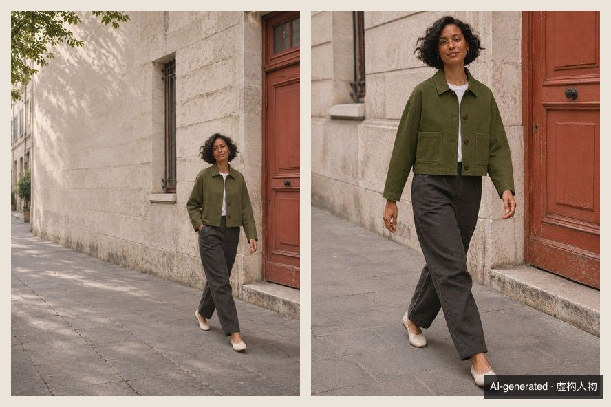
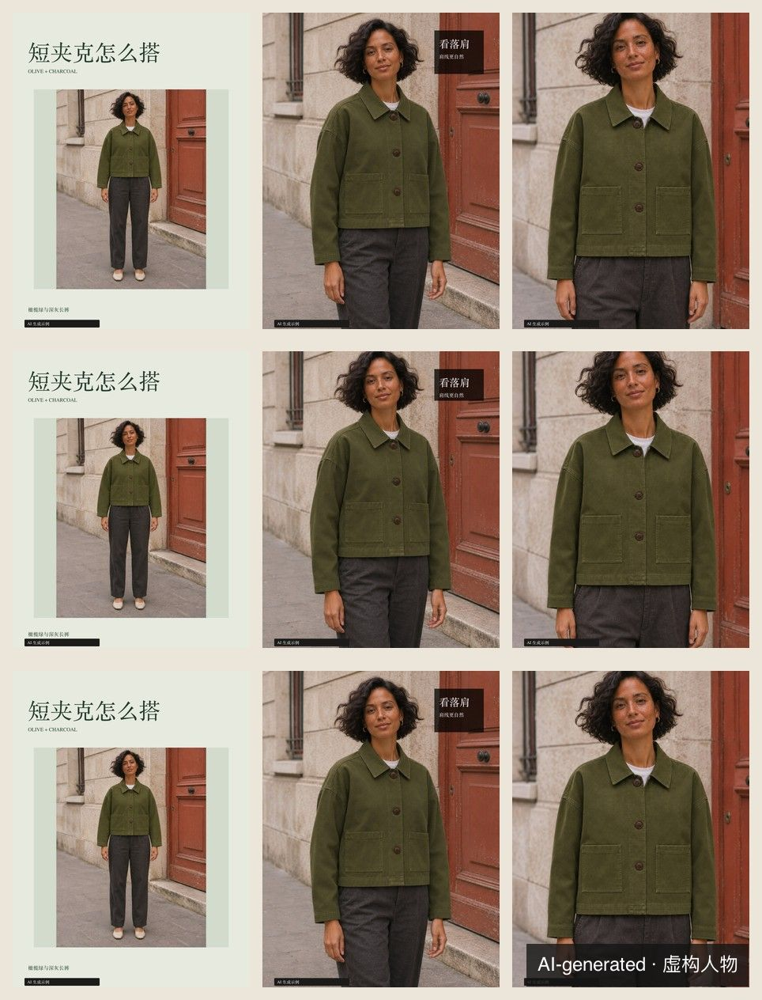
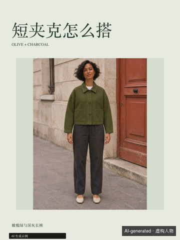

# 五层升级验证

样例使用原创提示词生成的虚构人物与短夹克，沿用正面全身、落肩、贴袋三个已复核商品镜头。项目单默认规划九张，新增环境大景和走动抓拍两张创意试拍。试拍没有入选商品保真交付。走动图的领口附近出现疑似多余纽扣，需要复查或局部重做。



三套尺寸均实际导出并逐页检查，共九页 PNG 和九页可编辑 SVG。图片第 1、2、3 行依次对应小红书 3:4、IG 4:5、IG 3:4。检查了封面、肩缝、两只贴袋、照片压字、中文字体及可见 AI 标识。三套均跑通交付命令，分别生成页序、缩略图与文案。信息流预览使用 360 px 宽度，三秒理解度需要独立读者计时，平台上传和主页裁切需使用发布账号实际预览。





## 自动测试

- 7 项旧版回归覆盖 20 款既有版式、接单缺图、工具与预算、裁切、重复图、定点返工、增量重排及交付。
- 6 项新增测试覆盖创意简报、动作和镜头参数、数值验收、稿号、调色复核、失败修复、三套导出、四种新版式、封面预览、文案、AI 标识、肖像授权状态、封面 A/B。
- 受控色块测试覆盖 ΔE76 通过、失败、待确认和替图使旧证据失效。样例夹克参考和全身街拍的取样差值为 1.56，因光线与白平衡未经匹配，结果为待确认。样例阈值为 5，可按业务另设。
- 封面 A/B 使用合成展示、点击、收藏数据验证计算和匹配逻辑。平台标识、真实浏览量与真人三秒测试均待实际发布或组织测试。样例工具未返回 seed，稿件如实记录为空。
- 字体隔离配置下，Fontconfig 识别随包的 Noto Sans CJK SC 和 Noto Serif CJK SC。两款字体与各自 OFL 许可证保存在排版 Skill 内。

复跑命令见 [README](../README.md)。色差样例可用以下命令检查。

```sh
node skills/ins-editorial-layout/scripts/project.cjs color examples/editorial-jacket/project.json \
  --config examples/editorial-jacket/color-config.json
```
